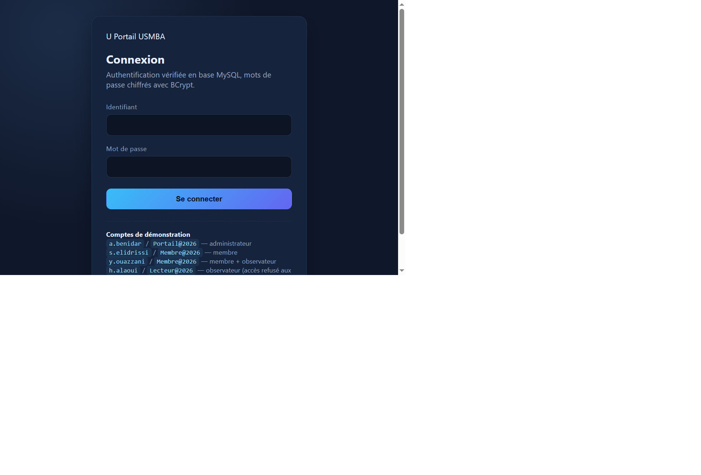
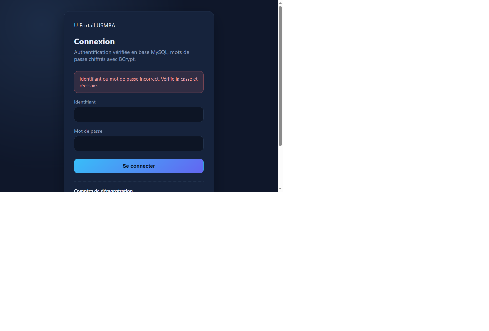
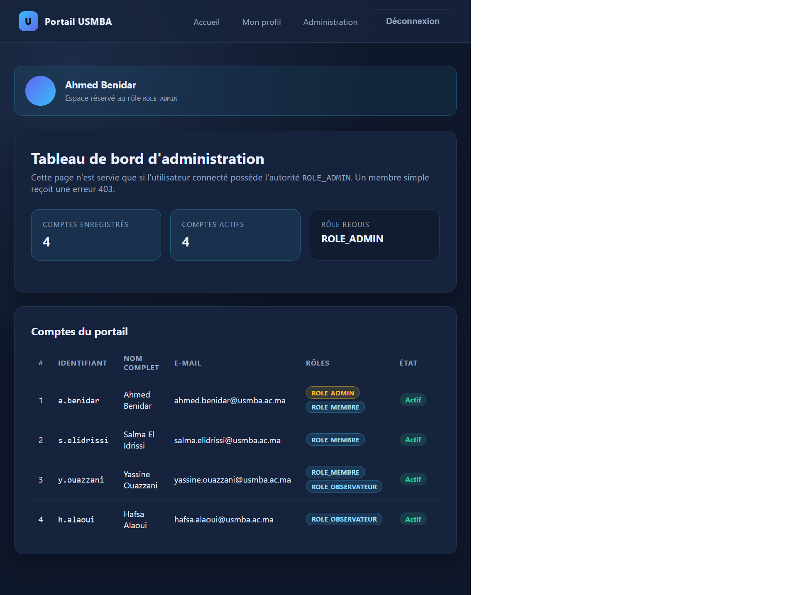
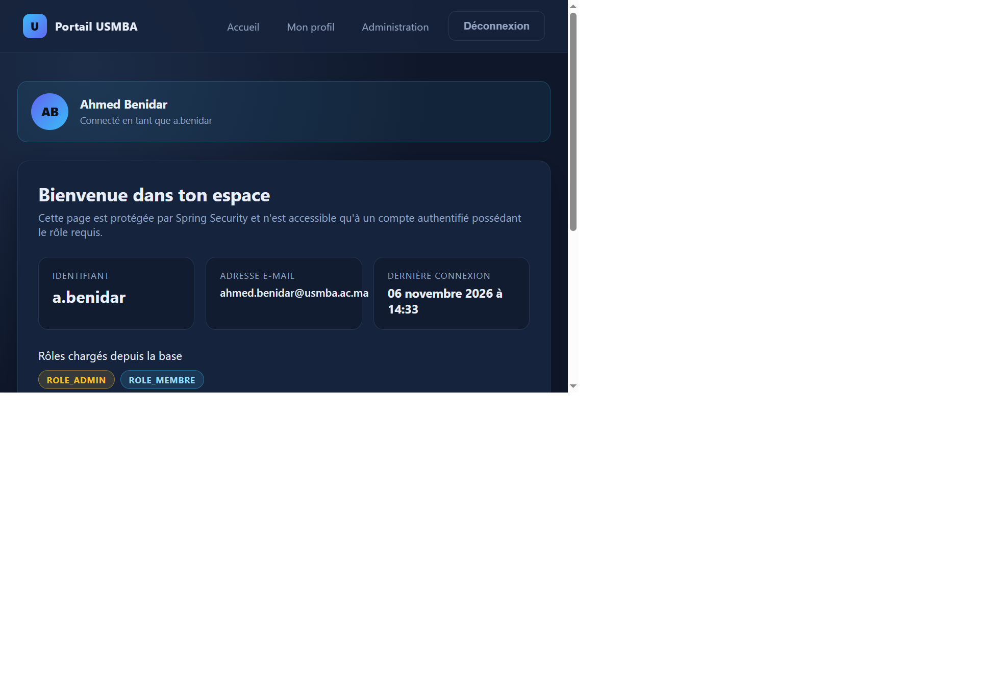
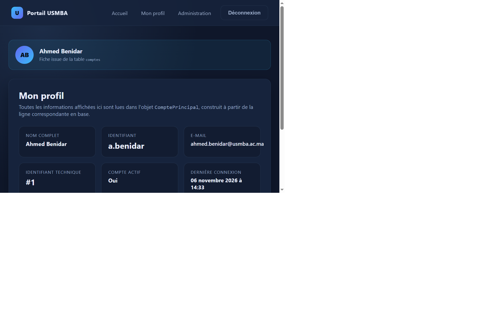
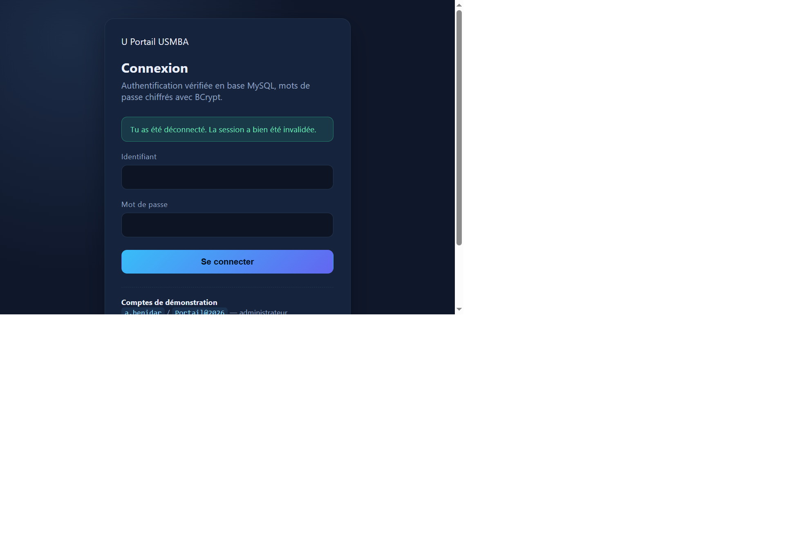
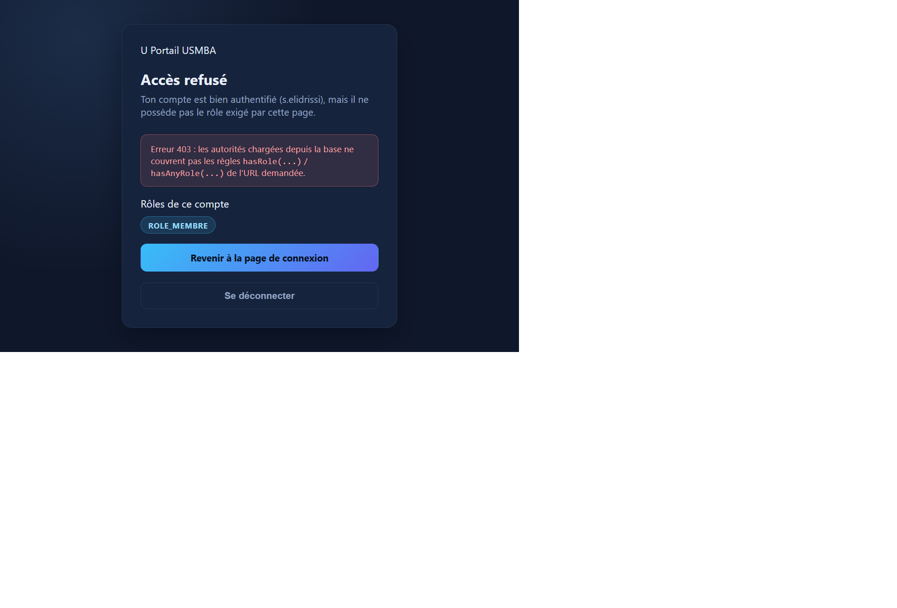

# TP 11 — Authentification JDBC / JPA avec Spring Security

## Résultats obtenus

### 1. Page de connexion personnalisée

Le formulaire remplace l'écran par défaut de Spring Security : il pointe sur `/connexion` en `POST` et utilise les
paramètres `identifiant` et `motDePasse` déclarés dans `SecuriteConfig`. Le jeton CSRF est injecté automatiquement par
Thymeleaf, ce qui permet de garder la protection contre les requêtes forgées.

### 2. Refus d'un mot de passe incorrect

Un couple identifiant / mot de passe invalide renvoie sur `/connexion?erreur=true`. Le contrôleur positionne alors le
drapeau `erreurIdentifiants` et le message d'erreur s'affiche au-dessus du formulaire, sans révéler si c'est
l'identifiant ou le mot de passe qui est faux.

### 3. Tableau de bord d'administration

Connecté avec `a.benidar`, l'utilisateur est redirigé par le `AuthenticationSuccessHandler` vers
`/administration/tableau-de-bord`. La page liste les quatre comptes avec leurs rôles issus de la table `roles` et leur
date de dernière connexion. Le lien « Administration » n'apparaît dans la barre de navigation que pour un administrateur,
grâce à l'expression `${#authorization.expression('hasRole(''ADMIN'')')}` de Thymeleaf.

### 4. Espace membre

La même session accède aussi à `/espace/accueil`, protégé par `hasAnyRole("MEMBRE","ADMIN")`. L'objet `ComptePrincipal`
expose le nom complet, l'e-mail et la liste des autorités réellement chargées depuis la jointure `comptes_roles`.

### 5. Profil détaillé du compte

La page `/espace/profil` affiche l'identifiant technique, l'état du compte et la date de dernière connexion. Cette
valeur a été mise à jour au moment du login : c'est la preuve que le handler de succès écrit bien en base après
l'authentification.

### 6. Déconnexion effective

La déconnexion se fait en `POST /deconnexion`, invalide la session HTTP et supprime le cookie `JSESSIONID`. L'utilisateur
revient sur la page de connexion avec un message de confirmation.

### 7. Contrôle d'accès refusé

Connecté avec `s.elidrissi` (rôle `ROLE_MEMBRE` seulement), une tentative d'accès à `/administration/tableau-de-bord`
est interceptée par Spring Security. Le serveur répond **403** et redirige vers la page personnalisée
`/acces-refuse`, qui rappelle les rôles du compte connecté.

---
